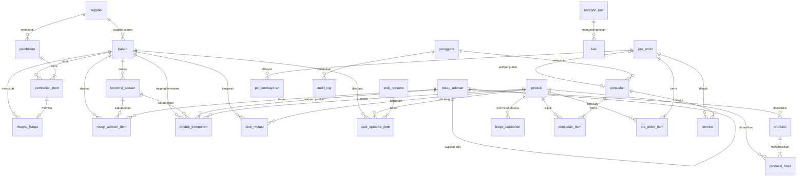
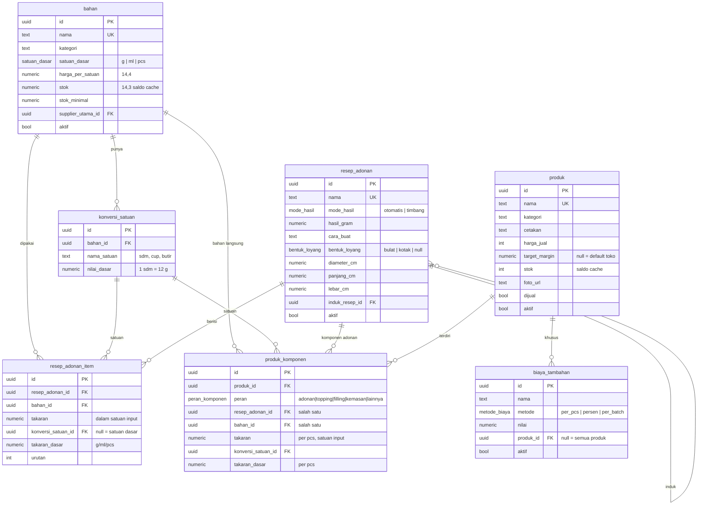
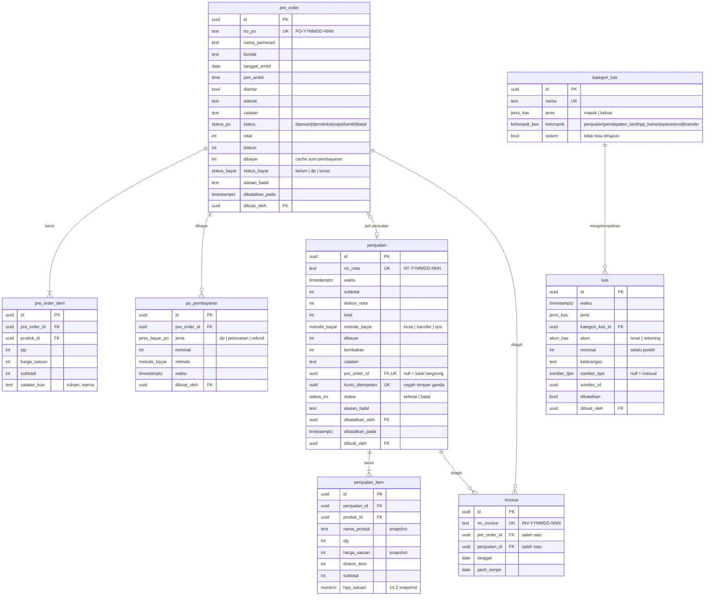
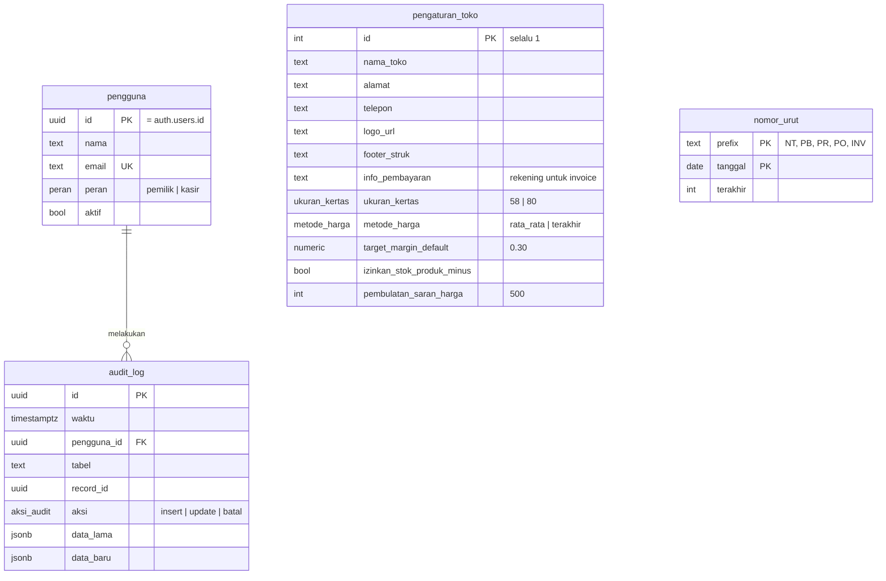

# ERD — Aplikasi Kasir & HPP Toko Kue Khansa

| | |
| --- | --- |
| Versi | 1.0 (draft) |
| Tanggal | 3 November 2026 |
| Database | PostgreSQL 15+ (Supabase) |
| Dokumen terkait | [PRD.md](PRD.md) · [PLAN.md](PLAN.md) |

Diagram memakai Mermaid (`erDiagram`). Diagram ini tampil langsung di GitHub dan VS Code (dengan ekstensi Markdown Preview Mermaid), atau bisa ditempel ke [mermaid.live](https://mermaid.live).

---

## 1. Prinsip desain

1. **Satuan dasar di mana-mana.** Takaran dan stok bahan selalu disimpan dalam g/ml/pcs. Satuan input (sdm, butir, kg) hanya di lapisan tampilan, tapi takaran asli juga disimpan agar bisa ditampilkan ulang.
2. **Tipe angka sesuai fungsinya.**

   | Jenis nilai | Tipe |
   | --- | --- |
   | Uang transaksi | `integer` (rupiah) |
   | Harga per satuan dasar | `numeric(14,4)` |
   | HPP snapshot | `numeric(14,2)` |
   | Takaran & stok bahan | `numeric(14,3)` |
   | Stok produk | `integer` |

3. **Transaksi tidak pernah dihapus.** Penjualan, pembelian, produksi, dan kas memakai status `batal` plus baris pembalik.
4. **Snapshot di titik transaksi.** HPP, nama produk, dan harga disalin ke baris transaksi agar laporan masa lalu tidak berubah walau master berubah.
5. **Buku besar stok.** `stok_mutasi` adalah sumber kebenaran. Kolom `bahan.stok` dan `produk.stok` adalah saldo cache yang diperbarui dalam transaksi yang sama, dan bisa direkonsiliasi kapan saja.
6. **FK eksplisit untuk relasi master.** Relasi "salah satu dari" (misal komponen = adonan **atau** bahan) memakai dua FK nullable plus `CHECK` tepat satu terisi, bukan kolom referensi polimorfik. Pengecualian: kolom `sumber_tipe` + `sumber_id` di tabel log append-only (`stok_mutasi`, `kas`, `audit_log`), karena hanya dipakai untuk penelusuran.
7. **Kolom standar.** Setiap tabel punya:
   - `id uuid` PK, default `gen_random_uuid()`
   - `dibuat_pada timestamptz`, default `now()`
   - `diubah_pada timestamptz` untuk tabel yang bisa diedit

   Tabel transaksi juga punya `dibuat_oleh uuid` (FK `pengguna`).

## 2. Diagram ringkas (semua tabel)



`stok_mutasi`, `kas`, dan `audit_log` juga menunjuk ke transaksi sumbernya lewat `sumber_tipe` + `sumber_id` (lihat prinsip 6). Relasi ini tidak digambar agar diagram tetap terbaca.

## 3. Diagram per domain

### 3.1 Master bahan, resep, dan produk (inti HPP)



### 3.2 Pembelian, produksi, dan stok

```mermaid
erDiagram
    supplier {
        uuid id PK
        text nama
        text kontak
        text catatan
        bool aktif
    }
    pembelian {
        uuid id PK
        text no_pembelian UK "PB-YYMMDD-NNN"
        date tanggal
        uuid supplier_id FK
        akun_kas akun_bayar "tunai | rekening"
        int total
        status_trx status "selesai | batal"
        text alasan_batal
        uuid dibuat_oleh FK
    }
    pembelian_item {
        uuid id PK
        uuid pembelian_id FK
        uuid bahan_id FK
        numeric jumlah_kemasan
        numeric isi_per_kemasan "dalam satuan dasar"
        numeric qty_dasar "jumlah x isi"
        int total_harga
        numeric harga_per_satuan "total / qty_dasar"
    }
    riwayat_harga {
        uuid id PK
        uuid bahan_id FK
        numeric harga_lama
        numeric harga_beli "null jika manual"
        numeric harga_baru
        sumber_harga sumber "pembelian | manual"
        uuid pembelian_item_id FK
        timestamptz berlaku_sejak
        uuid dibuat_oleh FK
    }
    produksi {
        uuid id PK
        text no_produksi UK "PR-YYMMDD-NNN"
        date tanggal
        uuid resep_adonan_id FK
        numeric faktor_skala
        numeric biaya_adonan "snapshot"
        status_produksi status "draft | selesai | batal"
        text catatan
        uuid dibuat_oleh FK
    }
    produksi_hasil {
        uuid id PK
        uuid produksi_id FK
        uuid produk_id FK
        int pcs_rencana
        int pcs_aktual
        int pcs_afkir
        numeric hpp_rencana "14,2"
        numeric hpp_aktual "14,2"
    }
    stok_mutasi {
        uuid id PK
        timestamptz waktu
        jenis_mutasi jenis
        uuid bahan_id FK "salah satu"
        uuid produk_id FK "salah satu"
        numeric qty "bertanda + / -"
        numeric saldo_sesudah
        numeric nilai_satuan "harga atau HPP saat itu"
        text alasan
        sumber_tipe sumber_tipe
        uuid sumber_id
        uuid dibuat_oleh FK
    }
    stok_opname {
        uuid id PK
        date tanggal
        target_opname target "bahan | produk"
        status_opname status "draft | final"
        text catatan
        uuid dibuat_oleh FK
    }
    stok_opname_item {
        uuid id PK
        uuid stok_opname_id FK
        uuid bahan_id FK "salah satu"
        uuid produk_id FK "salah satu"
        numeric stok_sistem
        numeric stok_fisik
        numeric selisih
        numeric nilai_selisih
    }

    supplier ||--o{ pembelian : memasok
    pembelian ||--|{ pembelian_item : berisi
    pembelian_item ||--o| riwayat_harga : memicu
    produksi ||--|{ produksi_hasil : menghasilkan
    stok_opname ||--|{ stok_opname_item : berisi
```



### 3.3 Penjualan, pre-order, invoice, dan keuangan



### 3.4 Sistem



## 4. Kamus data

Kolom standar (`id`, `dibuat_pada`, `diubah_pada`, `dibuat_oleh`) tidak diulang di tabel-tabel berikut kecuali punya aturan khusus.

### 4.1 Master

**`bahan`**

| Kolom | Tipe | Null | Aturan |
| --- | --- | --- | --- |
| nama | text | tidak | Unik (case-insensitive: indeks unik pada `lower(nama)`) |
| kategori | text | tidak | Daftar saran di UI: tepung, gula, dairy, lemak, telur, coklat, perisa, topping, kemasan, lainnya |
| satuan_dasar | enum `satuan_dasar` | tidak | `g`, `ml`, `pcs`. Terkunci setelah ada mutasi atau dipakai resep |
| harga_per_satuan | numeric(14,4) | tidak | ≥ 0, default 0 |
| stok | numeric(14,3) | tidak | Boleh negatif (PRD F-PRO-04). Default 0 |
| stok_minimal | numeric(14,3) | tidak | ≥ 0, default 0 |
| supplier_utama_id | uuid FK `supplier` | ya | `ON DELETE SET NULL` |
| aktif | boolean | tidak | Default true |

**`konversi_satuan`**

| Kolom | Tipe | Null | Aturan |
| --- | --- | --- | --- |
| bahan_id | uuid FK `bahan` | tidak | `ON DELETE CASCADE` |
| nama_satuan | text | tidak | Unik per bahan: `UNIQUE(bahan_id, lower(nama_satuan))` |
| nilai_dasar | numeric(12,4) | tidak | > 0 |

**`supplier`**: nama (wajib), kontak, catatan, aktif.

**`riwayat_harga`**

| Kolom | Tipe | Null | Aturan |
| --- | --- | --- | --- |
| bahan_id | uuid FK | tidak | |
| harga_lama | numeric(14,4) | tidak | |
| harga_beli | numeric(14,4) | ya | Harga per satuan dari pembelian. Null jika ubah manual |
| harga_baru | numeric(14,4) | tidak | Hasil metode harga (PRD §7.8) |
| sumber | enum `sumber_harga` | tidak | `pembelian`, `manual` |
| pembelian_item_id | uuid FK | ya | Wajib jika sumber = pembelian |
| berlaku_sejak | timestamptz | tidak | Indeks `(bahan_id, berlaku_sejak DESC)` |

### 4.2 Resep & produk

**`resep_adonan`**

| Kolom | Tipe | Null | Aturan |
| --- | --- | --- | --- |
| nama | text | tidak | Unik |
| mode_hasil | enum `mode_hasil` | tidak | `otomatis` = Σ takaran_dasar item bersatuan g dan ml (ml dianggap 1 g, dengan peringatan). Bahan bersatuan pcs tidak ikut dihitung, dan sistem memberi peringatan. `timbang` = input manual. Saran: bahan seperti telur memakai satuan dasar g dengan konversi "butir" |
| hasil_gram | numeric(14,3) | tidak | > 0. Di mode otomatis dihitung ulang setiap item berubah |
| bentuk_loyang, diameter_cm, panjang_cm, lebar_cm | | ya | Ukuran loyang acuan resep, untuk kalkulator skala. `CHECK`: bulat → diameter terisi; kotak → panjang & lebar terisi |
| induk_resep_id | uuid FK `resep_adonan` | ya | Diisi saat duplikat |

**`resep_adonan_item`**

| Kolom | Tipe | Null | Aturan |
| --- | --- | --- | --- |
| resep_adonan_id | uuid FK | tidak | `ON DELETE CASCADE` |
| bahan_id | uuid FK | tidak | `ON DELETE RESTRICT` |
| takaran | numeric(14,3) | tidak | > 0, sesuai satuan input |
| konversi_satuan_id | uuid FK | ya | Null = satuan dasar. Harus milik `bahan_id` yang sama (divalidasi di server) |
| takaran_dasar | numeric(14,3) | tidak | `takaran × nilai_dasar` saat disimpan. Dihitung ulang jika nilai konversi berubah |
| urutan | int | tidak | Urutan tampil |

**`produk`**

| Kolom | Tipe | Null | Aturan |
| --- | --- | --- | --- |
| nama | text | tidak | Unik |
| kategori | text | tidak | |
| cetakan | text | ya | Mis. "cup 50 ml", "loyang 20×20" |
| harga_jual | integer | tidak | ≥ 0 |
| target_margin | numeric(5,4) | ya | 0–0,95. Null = pakai `pengaturan_toko.target_margin_default` |
| stok | integer | tidak | Saldo cache. Boleh negatif hanya jika diizinkan pengaturan |
| foto_url | text | ya | Path di Supabase Storage |
| dijual | boolean | tidak | Tampil di kasir |
| aktif | boolean | tidak | |

> HPP produk **tidak disimpan** di tabel `produk`. HPP selalu dihitung saat dibutuhkan dari harga bahan terbaru (lihat §6). Snapshot HPP hanya ada di `produksi_hasil` dan `penjualan_item`.

**`produk_komponen`**

| Kolom | Tipe | Null | Aturan |
| --- | --- | --- | --- |
| produk_id | uuid FK | tidak | `ON DELETE CASCADE` |
| peran | enum `peran_komponen` | tidak | `adonan`, `topping`, `filling`, `kemasan`, `lainnya` |
| resep_adonan_id | uuid FK | ya | `CHECK (num_nonnulls(resep_adonan_id, bahan_id) = 1)` |
| bahan_id | uuid FK | ya | |
| takaran | numeric(14,3) | tidak | > 0. Untuk adonan: gram per pcs |
| konversi_satuan_id | uuid FK | ya | Hanya untuk komponen bahan |
| takaran_dasar | numeric(14,3) | tidak | Per pcs, dalam satuan dasar |

`CHECK`: jika `peran = 'adonan'` maka `resep_adonan_id IS NOT NULL`.

**`biaya_tambahan`**

| Kolom | Tipe | Null | Aturan |
| --- | --- | --- | --- |
| nama | text | tidak | Gas, listrik, tenaga |
| metode | enum `metode_biaya` | tidak | `per_pcs` (Rp/pcs), `persen` (0–1 dari biaya bahan), `per_batch` (Rp per resep) |
| nilai | numeric(14,4) | tidak | ≥ 0 |
| produk_id | uuid FK | ya | Null = berlaku untuk semua produk |

### 4.3 Stok & produksi

**`pembelian`** / **`pembelian_item`**

- `pembelian.total = Σ pembelian_item.total_harga`, divalidasi di server.
- `pembelian.akun_bayar` menentukan akun kas keluar.
- `pembelian_item.qty_dasar = jumlah_kemasan × isi_per_kemasan` (> 0).
- `pembelian_item.harga_per_satuan = total_harga ÷ qty_dasar`.

**`produksi`**

| Kolom | Tipe | Aturan |
| --- | --- | --- |
| faktor_skala | numeric(6,3) | > 0 |
| biaya_adonan | numeric(14,2) | Snapshot Σ(takaran_dasar × skala × harga saat selesai) |
| status | enum | `draft` → `selesai` (memicu mutasi) atau `batal`. Produksi `selesai` bisa dibatalkan pemilik → mutasi pembalik |

**`produksi_hasil`**: satu baris per produk yang dicetak dari adonan itu.

- `pcs_aktual ≥ 0`, `pcs_afkir ≥ 0`.
- `UNIQUE(produksi_id, produk_id)`.

**`stok_mutasi`** (append-only)

| Kolom | Tipe | Aturan |
| --- | --- | --- |
| jenis | enum `jenis_mutasi` | `stok_awal`, `pembelian`, `batal_pembelian`, `produksi_pakai`, `produksi_hasil`, `batal_produksi`, `penjualan`, `batal_penjualan`, `penyesuaian`, `opname` |
| bahan_id / produk_id | uuid FK | `CHECK (num_nonnulls(bahan_id, produk_id) = 1)` |
| qty | numeric(14,3) | ≠ 0. Positif = masuk, negatif = keluar |
| saldo_sesudah | numeric(14,3) | Saldo setelah mutasi, untuk kartu stok |
| nilai_satuan | numeric(14,4) | Harga bahan / HPP produk saat mutasi, untuk nilai penyesuaian |
| alasan | text | Wajib untuk `penyesuaian` (`CHECK`) |
| sumber_tipe | enum `sumber_tipe` | `pembelian`, `produksi`, `penjualan`, `opname`, `manual` |
| sumber_id | uuid | Id dokumen sumber |

Indeks: `(bahan_id, waktu)`, `(produk_id, waktu)`, `(sumber_tipe, sumber_id)`.

**`stok_opname`** / **`stok_opname_item`**

- Opname `draft` bisa diedit.
- Saat `final`, setiap item dengan `selisih ≠ 0` membuat satu `stok_mutasi` jenis `opname`.
- `CHECK (num_nonnulls(bahan_id, produk_id) = 1)`.

### 4.4 Penjualan & pre-order

**`penjualan`**

| Kolom | Tipe | Aturan |
| --- | --- | --- |
| subtotal | integer | Σ item.subtotal |
| diskon_nota | integer | 0 ≤ diskon ≤ subtotal |
| total | integer | subtotal − diskon_nota |
| metode_bayar | enum | `tunai`, `transfer`, `qris`. `tunai` → akun kas tunai; lainnya → rekening |
| dibayar, kembalian | integer | Hanya untuk tunai: `kembalian = dibayar − total ≥ 0` |
| pre_order_id | uuid FK | Unik jika terisi (satu PO → maksimal satu penjualan) |
| kunci_idempoten | uuid | Unik, nullable. Dikirim kasir per percobaan simpan agar klik ganda / kirim ulang tidak membuat nota ganda |
| status | enum `status_trx` | `selesai`, `batal`. `CHECK`: batal → alasan, oleh, pada terisi |

**`penjualan_item`**

- `subtotal = qty × harga_satuan − diskon_item`
- `qty > 0`, `0 ≤ diskon_item ≤ qty × harga_satuan`
- `hpp_satuan` = HPP produk saat transaksi (snapshot, presisi 2 desimal)

**`pre_order`**

- `total = Σ item.subtotal − diskon`
- `dibayar = Σ po_pembayaran.nominal`, di mana refund bernilai negatif
- `status_bayar`:
  - `belum` jika dibayar = 0
  - `dp` jika 0 < dibayar < total
  - `lunas` jika dibayar ≥ total
- Transisi status yang valid (divalidasi di server):

  ```
  dipesan → diproduksi → siap → diambil
  dipesan | diproduksi | siap → batal
  ```

- `diambil` hanya bisa jika `status_bayar = lunas`. Saat itu dibuat `penjualan` dengan `pre_order_id` terisi.
- `CHECK`: status `batal` → `alasan_batal` dan `dibatalkan_pada` terisi. `dibatalkan_pada` juga menjadi tanggal pengakuan DP hangus di laporan.

**`po_pembayaran`**: `nominal > 0`. Setiap baris membuat satu baris `kas`. Untuk jenis `refund`, kas keluar dan dihitung negatif di `dibayar`.

**`invoice`**

- `CHECK (num_nonnulls(pre_order_id, penjualan_id) = 1)`.
- Status invoice **tidak disimpan**. Status dihitung dari `status_bayar` PO, atau `lunas` untuk penjualan.

### 4.5 Keuangan

**`kategori_kas`**: kategori sistem (`sistem = true`) dibuat oleh seed dan tidak bisa dihapus/diubah jenisnya.

| Nama | Jenis | Kelompok |
| --- | --- | --- |
| Penjualan | masuk | penjualan |
| DP Pre-Order | masuk | penjualan |
| Pelunasan Pre-Order | masuk | penjualan |
| Pemasukan Bahan Sisa | masuk | pendapatan_lain |
| Pembelian Bahan | keluar | hpp_bahan |
| Refund Pre-Order | keluar | penjualan |
| Transfer Masuk / Transfer Keluar | masuk / keluar | transfer |
| Listrik, Gas, Gaji, Sewa, Iklan, Lain-lain | keluar | operasional |

> Laporan laba **tidak** dihitung dari tabel `kas`. Omzet dan HPP diambil dari `penjualan_item`. Biaya operasional dan pendapatan lain diambil dari `kas` berdasarkan kelompok. Dengan begitu DP yang masuk sebelum kue diambil tidak terhitung sebagai omzet terlalu dini (PRD §7.9).
>
> DP hangus tidak membuat baris kas baru. Laporan menghitungnya sebagai pendapatan lain dari PO berstatus `batal` dengan `dibayar > 0`.
>
> Pembatalan penjualan/pembelian **tidak** membuat baris kas pembalik. Baris kas asalnya ditandai `dibatalkan = true` sehingga keluar dari saldo. Refund PO adalah uang yang benar-benar keluar, jadi dicatat sebagai baris kas baru.

**`kas`**

| Kolom | Tipe | Aturan |
| --- | --- | --- |
| jenis | enum `jenis_kas` | `masuk`, `keluar`. Harus sama dengan jenis kategori |
| akun | enum `akun_kas` | `tunai`, `rekening` |
| nominal | integer | > 0 |
| sumber_tipe, sumber_id | | Null untuk input manual. Isi: `penjualan`, `pembelian`, `po_pembayaran`, `transfer` |
| dibatalkan | boolean | Kas otomatis dibatalkan lewat transaksi sumbernya. Kas manual bisa dibatalkan pemilik |

Saldo per akun = Σ masuk − Σ keluar, di mana `dibatalkan = false`.

### 4.6 Sistem

**`pengguna`**

- `id` sama dengan `auth.users.id` Supabase.
- Dibuat oleh trigger saat user diundang.
- Pengguna pertama otomatis `pemilik`.

**`pengaturan_toko`**: satu baris, `CHECK (id = 1)`.

**`nomor_urut`**: dipakai fungsi `ambil_nomor(prefix)`:

```sql
INSERT INTO nomor_urut (prefix, tanggal, terakhir)
VALUES ($1, (now() AT TIME ZONE 'Asia/Jakarta')::date, 1)
ON CONFLICT (prefix, tanggal)
DO UPDATE SET terakhir = nomor_urut.terakhir + 1
RETURNING terakhir;
```

Aman untuk transaksi bersamaan karena baris terkunci sampai transaksi selesai.

**`audit_log`**

- Ditulis oleh lapisan server (bukan trigger) untuk perubahan:
  - `bahan.harga_per_satuan`
  - `produk.harga_jual`
  - penyesuaian/opname stok
  - semua pembatalan
  - perubahan peran pengguna
- Indeks `(tabel, record_id)`, `(waktu DESC)`.

## 5. Daftar enum

| Enum | Nilai |
| --- | --- |
| `satuan_dasar` | g, ml, pcs |
| `mode_hasil` | otomatis, timbang |
| `bentuk_loyang` | bulat, kotak |
| `peran_komponen` | adonan, topping, filling, kemasan, lainnya |
| `metode_biaya` | per_pcs, persen, per_batch |
| `sumber_harga` | pembelian, manual |
| `status_trx` | selesai, batal |
| `status_produksi` | draft, selesai, batal |
| `jenis_mutasi` | stok_awal, pembelian, batal_pembelian, produksi_pakai, produksi_hasil, batal_produksi, penjualan, batal_penjualan, penyesuaian, opname |
| `sumber_tipe` | pembelian, produksi, penjualan, opname, po_pembayaran, transfer, manual |
| `target_opname` | bahan, produk |
| `status_opname` | draft, final |
| `metode_bayar` | tunai, transfer, qris |
| `status_po` | dipesan, diproduksi, siap, diambil, batal |
| `status_bayar` | belum, dp, lunas |
| `jenis_bayar_po` | dp, pelunasan, refund |
| `jenis_kas` | masuk, keluar |
| `kelompok_kas` | penjualan, pendapatan_lain, hpp_bahan, operasional, transfer |
| `akun_kas` | tunai, rekening |
| `peran` | pemilik, kasir |
| `ukuran_kertas` | 58, 80 |
| `metode_harga` | rata_rata, terakhir |
| `aksi_audit` | insert, update, batal |

## 6. Perhitungan turunan (tidak disimpan)

Nilai berikut **dihitung**, tidak disimpan sebagai kolom, agar selalu memakai harga terbaru. Implementasinya berupa fungsi TypeScript murni (`lib/hpp/`) yang diuji unit, plus satu query yang memuat semua data yang dibutuhkan.

| Nilai | Sumber |
| --- | --- |
| Biaya total & per gram adonan | `resep_adonan_item.takaran_dasar × bahan.harga_per_satuan` ÷ `resep_adonan.hasil_gram` |
| HPP per pcs & rinciannya | `produk_komponen` + biaya adonan + `biaya_tambahan` |
| Pcs per resep | `floor(hasil_gram ÷ gram_per_pcs adonan utama)` |
| Margin & saran harga | HPP + `produk.harga_jual` + target margin |
| Status invoice | `pre_order.status_bayar` |
| Saldo kas | Σ `kas` per akun |

Jika nanti halaman daftar produk terasa lambat (> 100 produk), tambahkan materialized view `v_hpp_produk` yang di-refresh setelah perubahan harga atau resep.

## 7. Invarian & rekonsiliasi

Dicek oleh test integrasi dan oleh fungsi `cek_integritas()` yang bisa dijalankan pemilik dari halaman pengaturan:

1. `bahan.stok = Σ stok_mutasi.qty` per bahan.
2. `produk.stok = Σ stok_mutasi.qty` per produk.
3. `penjualan.total = Σ penjualan_item.subtotal − diskon_nota`, untuk semua penjualan.
4. `pre_order.dibayar = Σ po_pembayaran.nominal` (refund negatif).
5. Setiap penjualan, pembelian, dan po_pembayaran berstatus aktif punya tepat satu baris `kas` aktif. Pengecualian: penjualan dari PO tidak punya kas, karena kasnya sudah dari po_pembayaran.

## 8. Keamanan data

- Semua tabel di schema `public` **mengaktifkan RLS tanpa policy** (deny-all). Akibatnya anon key Supabase yang ada di browser tidak bisa membaca/menulis tabel apa pun lewat PostgREST.
- Seluruh akses data lewat server Next.js memakai Drizzle dengan koneksi database langsung. Hak akses dicek di server per aksi (`requirePeran('pemilik')`).
- Response untuk kasir memakai DTO terpisah yang **tidak** memuat `hpp_satuan`, `harga_per_satuan`, `biaya_*`, atau laba.
- Supabase Storage (logo, foto produk): bucket publik-baca untuk foto produk, upload hanya lewat server.
